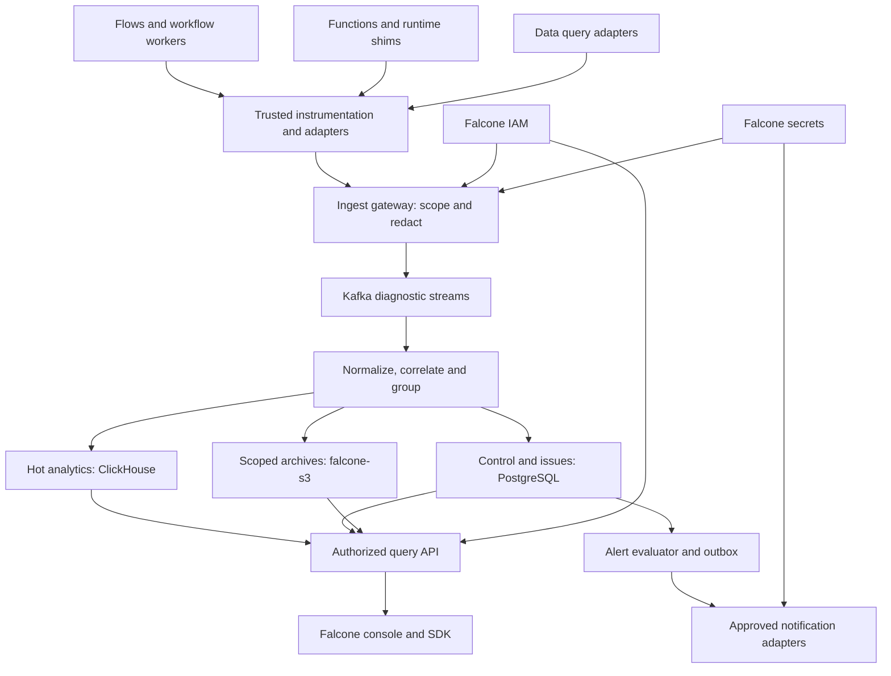
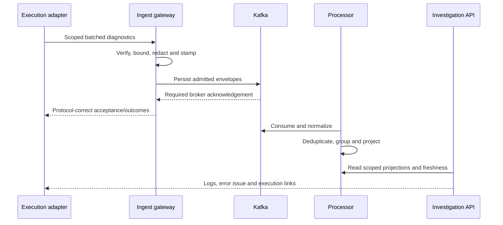

# Baseline architecture

Status: proposed. The product is custom Falcone functionality; existing storage, protocol and cryptographic components are reused. Backend placement and sizing require the gates in [operations](operations.md).

## Topology

Collector/exporter persistent queues must contain **already sanitized** records. Place authentication, trusted scope stamping and mandatory redaction before the first persistent diagnostic queue. A generic Collector configuration with a pre-redaction WAL does not meet this design. Bad events are rejected or reduced to safe rejection metadata; raw quarantine is disabled by default.

## Technology and responsibility

| Module | Recommended stack | Rationale and boundary |
|---|---|---|
| Management/query/error API | TypeScript/Node.js, Falcone conventions and OpenAPI | Reuse domain contracts and permissions; compile a bounded query AST rather than expose raw SQL |
| Producer instrumentation | OTel SDKs for Node/Go/Python and explicit Falcone adapters | Standard trace/log fields plus authoritative runtime lineage; automatic instrumentation alone is insufficient |
| Ingestion | OTLP HTTP/protobuf initially, optional gRPC; curated Go OTel gateway/custom auth/redaction boundary | Bounded batching/backpressure with namespace-level deployment; preserve standard response/partial-success semantics |
| Processing/grouping | TypeScript workers initially, profiled before splitting hot paths into Go | Versioned normalization and deterministic grouping, durable inbox and transactional issue updates |
| Durable transport | Existing Falcone Kafka, dedicated diagnostic topics/ACLs | Decouple telemetry from producers and index outages; preserve a separate governed audit path |
| Product/error state | Separate database/schema and roles on approved PostgreSQL | RLS, unique occurrence identities, issue transitions, saved views, policies, alerts and outbox |
| Hot telemetry | Operator-approved ClickHouse | Time/field analytics over logs/spans/query summaries; trusted query gateway and backend-enforced access policy |
| Archive/debug/export artifacts | `falcone-s3` bindings, native or external backing | Immutable scoped Parquet/debug files, manifests and retention; credentials through secrets |
| Console | Main Falcone console and shared UI conventions | One login/navigation/tenant context; no competing Sentry organization/team product |
| Metrics | Existing Prometheus/Grafana plus bounded service telemetry | Operational health and trustworthy denominators; not error-sample-derived billing |
| Deployment | Ordinary Deployments/approved PVCs, Helm/manifests, namespaced RBAC | No new operator, CRD, privileged DaemonSet, host filesystem or eBPF prerequisite |

ClickHouse is a new prerequisite unless an approved instance already exists; no compatible backend installation is inferred. An operator-managed Loki/OpenSearch adapter is an alternative decision, requiring capability and query tests. PostgreSQL-only is an explicitly bounded development/small-install profile, not an automatic high-volume fallback.

## Ingestion and investigation flow

1. A flow node calls a function, which calls a datasource. Trusted dispatch/shim/query adapters propagate trace context and stable Falcone run/node/attempt/activation/query IDs. Untrusted code can supply log text, not tenant identity or execution authority.
2. Instrumentation emits allowed fields and bounded sanitized exceptions. The gateway verifies credentials/resource scope, strips conflicting identity attributes, applies redaction and quota decisions, and persists accepted envelopes to Kafka before returning durable acceptance.
3. Consumers normalize event versions, link spans/events and update error occurrence/issue state idempotently. ClickHouse and archive projections advance independently with explicit high-water marks. A Kafka commit, PostgreSQL commit and ClickHouse insert are not one transaction.
4. The console calls the query API with current IAM context. A compiled allowlisted query includes scope on every lookup, facet, join, cursor and archive partition. A trace ID or correlation ID is never authorization.
5. The investigation page links log lines to a grouped issue, function attempt, flow node and sanitized query summary. Workflow/function status comes from the authoritative owning API; missing diagnostics appear as incomplete evidence.
6. Alert transitions use a durable outbox and approved destination configuration. Outage buffering, deduplication and notification uncertainty are visible. Diagnostics alone do not rerun code or change a workflow.

## Consistency and failure behavior

Normal application diagnostics use bounded asynchronous export: an unavailable logs service must not indefinitely block a function or database operation. Buffer/drop behavior and counters are explicit. This does **not** relax existing governed audit transaction requirements, such as Falcone's `AUDIT_UNAVAILABLE` path.

Ingest acceptance means the configured broker persistence condition was met, not that search, issue grouping, alerts and archive are already current. Return/record watermark and quality information. Index failures accumulate lag and apply backpressure before retention capacity is exhausted. IAM denial, invalid scope and privacy-policy failure never fall back to an unfiltered endpoint. A missed source event cannot be reconstructed merely by replaying downstream telemetry.

Core ingestion, search, issue state and alert evaluation cannot depend synchronously on falcone-workflow or serverless being healthy. Optional workflow-based notifications/remediation are downstream consumers with independent failure reporting. Service self-monitoring also needs a minimal external health/metrics path to avoid recursive logging storms.
